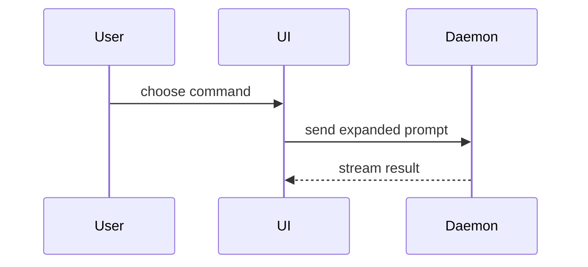

# Pull Requests

## Title

Pull request titles must follow this format:

```text
<ticket>: <name>
```

- Omit the optional `<ticket>:` prefix when no ticket exists.
- Make `<name>` an imperative description of the change, such as
  `Add Singapore country`.
- Match the ticket identifier and name to the [branch name](branches.md).
  Use the applicable ticket conventions for the identifier's format and casing.

Example: `<ticket>: Add minor feature`

## Body Template

Use this template for writing the PR body:

```markdown
## Summary

<diagram, diff-sketch, or tree>

## Evidence

### Before

<recording, screenshot, or execution output from the PR base>

### After

<matching evidence from the changed version>

## Merge Danger

**Door:** <one-way or two-way>

<optional: description>

**Blast Radius:** <one-word description>

<optional: potential ramifications of merge>
```

## Body Sections

Skip all preambles and keep prose brief. Use the user or project's domain language.

### Summary

Pick the smallest view that makes the key point clear.

- Show logic or an algorithm as pseudocode:

```text
on(save)
  if content is unchanged
    return cached result
  write new content
  return fresh result
```

- Show runtime control flow as a call tree:

```text
submitForm
  createSession
    persistPrompt
    launchAgent
  navigateToSession
```

- Show UI structure as a component tree, including state and module boundaries that matter:

```text
<SessionPage> (apps/example/src/routes/session.tsx)
  useSessionEvents()
  <SessionToolbar>
    <RunSkillButton> (packages/ui)
```

- Show file responsibility or a broad refactor as a shallow file tree:

```text
src/
├── commands/       # parses user actions
├── sessions/       # owns session state
└── transport/      # sends API requests
```

- Show component interaction, control flow, or data flow with Mermaid:



- Use `diff` when the point is what changes and the surrounding shape already exists. Match the diff shape to the topic.

For a component change:

```diff
 <SessionPage>
   useSessionEvents()
   <SessionToolbar>
+    <RunSkillButton />
   <SessionTimeline>
+    <SkillResultCard />
```

For a file-layout change:

```diff
 src/
 ├── commands/
+│   └── show-me.ts       # expands the slash command
 ├── sessions/
-└── transport.ts
+└── transport/
+    ├── client.ts
+    └── stream.ts
```

For a call-tree or call-stack change:

```diff
 submitForm
   createSession
     persistPrompt
+    expandSkillMention
     launchAgent
-  navigateToSession
+  navigateToSession
+    subscribeToEvents
```

For a state or control-flow change:

```diff
 on(save)
-  write content
+  if content is unchanged
+    return cached result
+  write new content
+  invalidate cache
```

- Show the whole block when most of it is new, when omitted context would hide ownership or order, or when the user needs a copyable target shape:

```ts
function expandSkill(command: string): string {
  const skillName = command.slice(1);
  return `use the ${skillName} skill`;
}
```

#### Guidance

Place each visual next to the short text it supports. Keep only the calls, files, props, states, and boundaries needed to answer the user's current question or the options to resolve the current discussion point.

You may use one of these, you may use several, it is unlikely you will use all of them. Use your judgement and don't overwhelm the user.

### Evidence

Recordings and screenshots are S-tier evidence. Put them first in Evidence.

- If the PR adds a feature or changes visible behavior, record the affected user journey on the changed version. If the PR base has a comparable journey, record that journey on the base version. Attach the recordings under **Before** and **After**.
- If a new feature has no meaningful before state, replace **Before** and **After** with **Preview**. Attach a recording that shows the new feature in use.
- If the change only affects layout, colors, copy, or other static content, attach matching before and after screenshots.
- If the change has no visible behavior or appearance to capture, use execution evidence. Test results and command output are A-tier evidence. Show the output of the same test or command on both versions when possible.

If you cannot capture a required recording or screenshot, state what is missing and why. Include the evidence you can collect.

After you publish or update the PR, make sure that the body displays each screenshot and plays each recording.

### Merge Danger

Describe whether it's a one-way or two-way door. You can walk back through two-way doors, but not one-way doors. A PR that is cheap to roll back is lower risk. Changes that involve destructive actions or hard-to-reverse decisions are one-way doors.

The blast radius is the potential impact or scope of the changes introduced by this PR. Consider all possibilities. Examples are layout shift, breakages for consumers, mobile responsiveness, etc.
